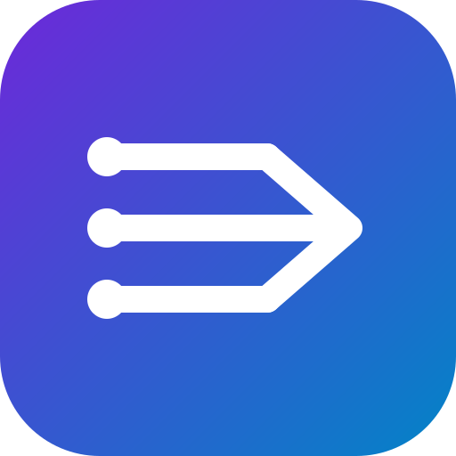
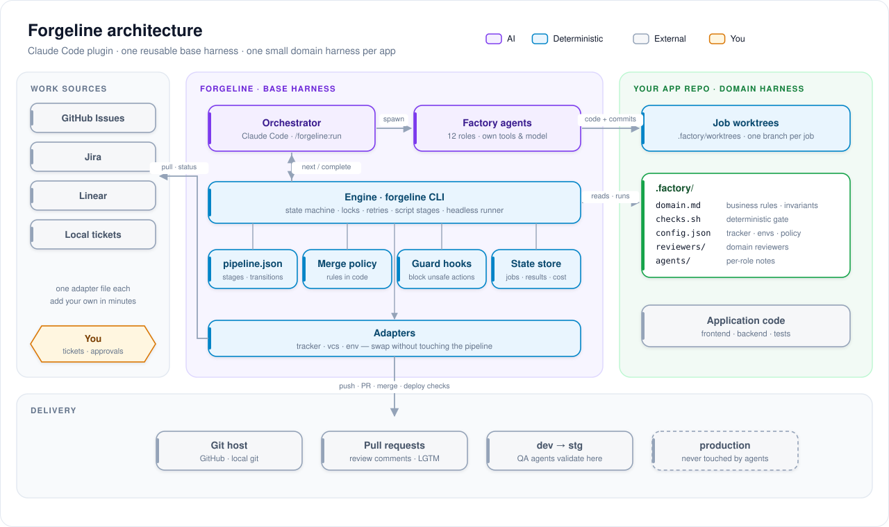
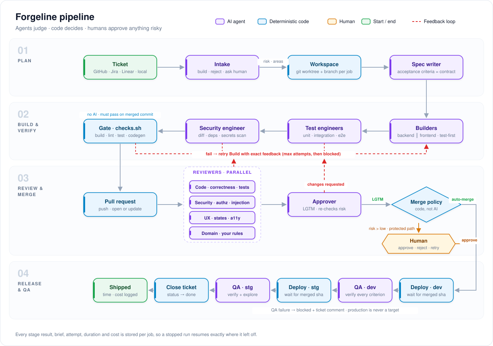

<p align="center">
  
</p>

<h1 align="center">Forgeline</h1>

<p align="center">
  <strong>Ticket in, reviewed PR out.</strong><br>
  A Claude Code harness where agents do the work and guardrails they can't edit decide what ships.<br>
  Factory agents, a deterministic gate, merge policy in code, guard hooks and pluggable trackers.
</p>

---

## Install

In Claude Code:

```text
/plugin marketplace add Nabwinsaud/forgeline
/plugin install forgeline@forgeline
```

or in one step (Claude Code 2.1.275+): `/plugin install forgeline --marketplace Nabwinsaud/forgeline`

Or set everything up from a terminal in one step, inside **your app repo**:

```sh
npm create forgeline      # or: bunx create-forgeline
```

It checks your repo, writes `.factory/` with safe defaults, runs your gate once and installs the
plugin. See [packages/create-forgeline](packages/create-forgeline).

Then, inside **your app repo**:

```text
/forgeline:init          # detects your stack (Go, TS, Python, Rust, Java, Ruby, monorepos), writes .factory/
/forgeline:do add a health endpoint      # one sentence in, reviewed PR out
```

No tracker needed. From a terminal it's `forgeline do "add a health endpoint"`. When you're ready,
point it at GitHub Issues, Jira or Linear and use `/forgeline:run` to work through the queue.

Requirements: Claude Code, git, Python 3.10+ (macOS/Linux ship it). Optional: `gh`, `gitleaks`, `codex`.

## What you get

| | | |
|---|---|---|
| **12 factory agents** | intake, spec-writer, backend/frontend builders, unit & e2e test engineers, security engineer, code / security / UX reviewers, approver, QA validator | each with its own tools (reviewers are read-only), model and preloaded skills |
| **22 skills** | 9 commands (`/forgeline:do`, `run`, `learn`, `init`, `status`, `approve`, `ticket`, `doctor`, `report`) and 13 engineering skills (TDD, verification, specs, review, security, API design, migrations, Go, React, Python, Playwright, QA, git) | |
| **Engine** | `forgeline` CLI on your PATH: a deterministic state machine with locks, retries, worktrees, a headless runner, metrics | agents judge, code decides |
| **Guard hooks** | block force-push, agents pushing to main or merging, agents editing the gate/policy, edits to generated code, secrets in code; profiles `minimal` · `standard` · `strict` | active only in repos with `.factory/` |
| **Domain packs** | `forgeline pack add money` (or `auth`, `api`, `web-app`, a folder, a git URL): business rules, a reviewer for them, and a gate check, in one command | |
| **Rule packs** | always-on standards for common, Go, TypeScript/React, Python, installed into your repo by `init` | |
| **Adapters** | trackers: local · GitHub · Jira · Linear; git: local · GitHub; environments: none · URL poll · any command | add one in a single file |

## Architecture

<p align="center">
  
</p>

- **Base harness** (this plugin): the same for every app. Agents, skills, hooks, engine, policy, adapters.
- **Domain harness** (`.factory/` in your repo): what makes it *your* factory. `domain.md` (business rules
  and invariants every agent reads), `checks.sh` (your merge gate), `config.json` (tracker, environments,
  policy, models), `reviewers/` (your own expert reviewers, e.g. privacy or finance).

## Pipeline

<p align="center">
  
</p>

- **Agents judge, code decides.** Agents return `pass | fail | changes_requested | needs_human | reject | skip`;
  `pipeline.json` decides what happens next. Agents never merge, push the base branch or touch tickets, and
  the guard hooks enforce that.
- **Deterministic gate.** `.factory/checks.sh` must pass on the exact commit that gets merged. Agents cannot
  edit it.
- **Merge policy in code.** Auto-merge only up to the risk level you allow; protected paths always go to a
  human. New repos start with auto-merge **off**.
- **Feedback loops.** Test, security, gate and review failures are fed into the next build attempt. There
  are max attempts, then the job is `blocked`.
- **Durable and parallel.** All state lives in `.factory/state/`, so you can stop anytime and resume. One
  git worktree per job, jobs run in parallel, and reviewers run in parallel.
- **Observable.** Time, attempts and real cost per stage: `forgeline report`.

## Two ways to run

| | Interactive | Headless |
|---|---|---|
| How | `/forgeline:run` in Claude Code | `forgeline run` (cron, CI, a server) |
| Agents | Claude Code subagents (`forgeline:<role>`) | `claude -p` per task, or `--runner codex` |
| Cost tracking | from agent reports | real token usage and $ from the runner |

## Make it yours

```text
.factory/
├── domain.md          what the business is, invariants, high-risk areas, glossary, test accounts
├── checks.sh          your gate: build · lint · test · codegen freshness · secrets · your own checks
├── config.json        tracker · git host · dev/stg URLs · policy · models · hook profile
├── reviewers/*.md     extra reviewers that run in parallel with code/security/UX
└── agents/<role>.md   extra notes for one role (e.g. QA test accounts)
```

See [docs/getting-started.md](docs/getting-started.md), [docs/configuration.md](docs/configuration.md),
[docs/hooks.md](docs/hooks.md), [docs/architecture.md](docs/architecture.md).

## Safety

- Hooks act only in repos that opted in (`.factory/config.json`); the rest of your projects are untouched.
- Credentials come from env vars or your existing `gh` login, never from config files.
- QA agents only get the dev/stg URLs and test accounts you list. Production is never a target.
- Ticket text is untrusted input: limit who can mark tickets ready for the factory.

## What's next

**Just shipped:** `forgeline do` (one sentence in, no tracker needed), zero-config setup for most
stacks and monorepos, intake that asks questions instead of guessing, `forgeline watch` and
`replay`, `forgeline learn` (repeated review findings become rules), domain packs, and
rebase-and-regate before every merge.

Planned work lives in [milestones](https://github.com/Nabwinsaud/forgeline/milestones). Each one is a single theme:

| Milestone | Goal |
|---|---|
| [**Safe merges**](https://github.com/Nabwinsaud/forgeline/milestone/1) | agents never hold push credentials; hooks that fail closed |
| [**The plan is the contract**](https://github.com/Nabwinsaud/forgeline/milestone/2) | tests can't be quietly weakened; plan changes need a human; every result is tied to the commit it checked |
| [**Parallel without pain**](https://github.com/Nabwinsaud/forgeline/milestone/3) | file leases between jobs, automatic worktree cleanup, a fast path for tiny tickets |
| [**Easier to adopt**](https://github.com/Nabwinsaud/forgeline/milestone/4) | `create-forgeline` drafts your `domain.md` from the code, plus adapter fixes |
| [**Later**](https://github.com/Nabwinsaud/forgeline/milestone/6) | earned autonomy (shadow mode and a track record before auto-merge), more agent runtimes (Codex, Copilot, Gemini, local models), running as a GitHub Action or on a server |

Ideas and feedback welcome in [issues](https://github.com/Nabwinsaud/forgeline/issues).

## License

MIT
